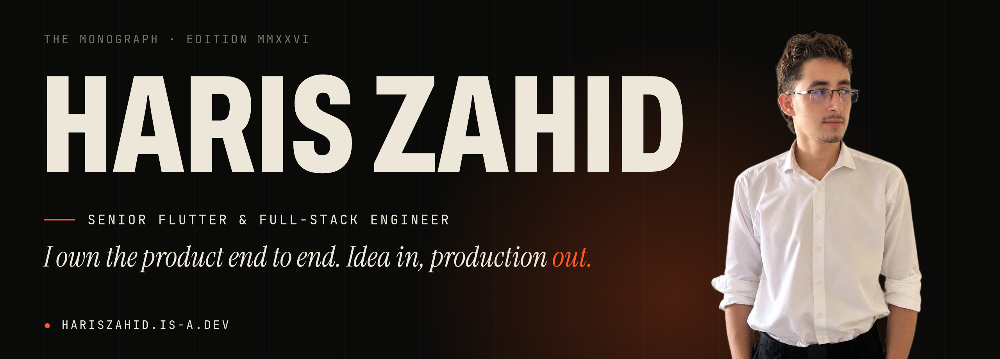
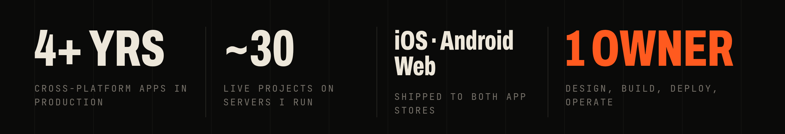
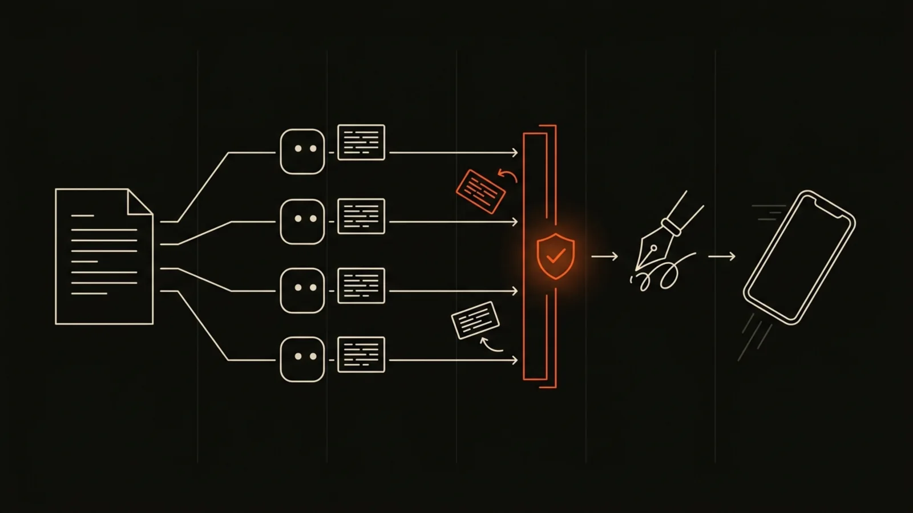
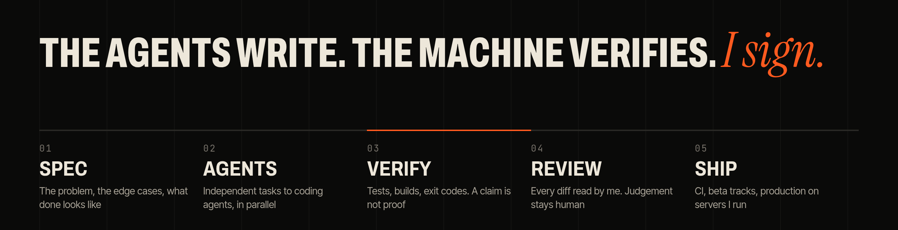

  
  
  
  

Flutter apps, voice AI and the FastAPI backends behind them. I design, build, ship and run the whole product, and I'm the engineer you call **when the demo works and production doesn't.**

## Selected work

<table>
  <tr>
    <td width="50%" valign="top">
      
       VOL. I · BREWLY · SYSTEM ARCHITECT
      <h3>Voice ordering</h3>
      A LiveKit voice agent takes café orders while web, mobile and kitchen stay in sync over WebSockets.
       <a href="https://hariszahid.is-a.dev/volumes/the-voice-at-the-counter">Case study →</a>
    </td>
    <td width="50%" valign="top">
      
       VOL. II · TIER75 · VOICE SYSTEMS ENGINEER
      <h3>0 licence fees</h3>
      An on-device wake word in ONNX that matches the commercial engine, after finding the fault in the audio pipeline, not the model.
       <a href="https://hariszahid.is-a.dev/volumes/the-listening-machine">Case study →</a>
    </td>
  </tr>
  <tr>
    <td width="50%" valign="top">
      
       VOL. III · SCALE APP · LEAD FLUTTER ENGINEER
      <h3>Chat → broker</h3>
      Live support chat with escalation, direct broker chat and an in-app assistant that performs actions.
       <a href="https://hariszahid.is-a.dev/volumes/the-escalation-path">Case study →</a>
    </td>
    <td width="50%" valign="top">
      
       VOL. V · MERIDIAN · AUTHOR
      <h3>Exit codes only</h3>
      An orchestrator that runs coding agents in parallel waves and accepts only work verified by real commands.
       <a href="https://hariszahid.is-a.dev/volumes/the-autonomous-foreman">Case study →</a>
    </td>
  </tr>
</table>

<a href="https://hariszahid.is-a.dev/#volumes"><b>All eight case studies →</b></a>

## How I work

I build with AI agents every day (Claude Code, Codex, Antigravity, MCP servers) and treat them like a very fast team that never gets the final word. The full method is published as [The Production Doctrine](https://hariszahid.is-a.dev/#doctrine).

## The stack, in five layers

| Layer | |
| --- | --- |
| **Intent** Why it should exist | Scoping & roadmaps · Figma to production · Onboarding flows · Beta programmes · Release strategy |
| **Interface** Where people meet it |       |
| **Signal** Where milliseconds decide trust |       |
| **Intelligence** AI that reasons and acts |      |
| **Infrastructure** Where it keeps running |         |

## On GitHub

  
  

  

## Writing

- **[Your next customer may never see your website](https://www.linkedin.com/in/haris-zahid-762b49370/recent-activity/all/)**: discovery is moving from search, to assistants, to agents negotiating with agents.
- **[The model was never deaf](https://www.linkedin.com/in/haris-zahid-762b49370/recent-activity/all/)**: a wake-word field note on why the fault lived in the Linux audio daemon all along.

---

  <b>Would twenty minutes on your product be a bad idea?</b> 
  <a href="mailto:hariseldev@gmail.com">hariseldev@gmail.com</a> · English for work, also Urdu, Punjabi and Pashto 
  “No, not yet” is a perfectly good answer too.

